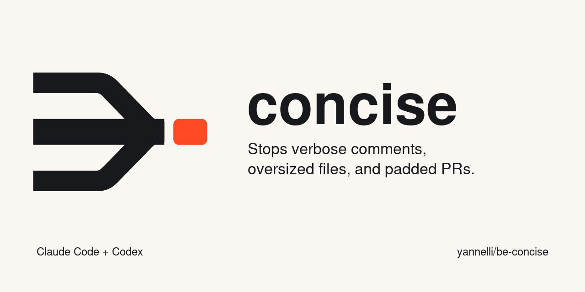

# Be Concise

Be Concise (plugin id `concise`) is a Claude Code, Codex, and omp plugin that catches the agent's own verbosity before a write or GitHub command runs. It also filters test-runner output before the agent reads it.

New here? Start with [plugins/concise/README.md](plugins/concise/README.md).

## What it checks

- Comment blocks longer than 2 lines in `Write`, `Edit`, `MultiEdit`, and Codex `apply_patch` additions
- New files longer than 300 lines
- Inline `gh pr` and `gh issue` bodies with more than 1 prose paragraph or more than 3 sentences in a paragraph
- Em dashes and 47 categories of AI writing patterns, both off until you turn them on
- Output from pytest, `go test`, npm test, Jest, and Vitest; each run's full output is kept in its own log under `$TMPDIR`, and the path is printed with the filtered output. Claude Code filters a passing run after it ends and leaves failed runs whole. Codex and omp rewrite the command so the filter runs with it

Structured GitHub bodies that use headings and lists are allowed. A denied call includes the exact limit and location. After 2 denied retries for the same target, Concise permits the next attempt and flags it.

## Install

Git, Node.js, Bash, `jq`, `realpath`, and core Unix tools must be available on `PATH`.

### Claude Code

Run these commands inside Claude Code:

```text
/plugin marketplace add https://github.com/yannelli/be-concise
/plugin install concise@be-concise
```

Review the hooks and choose an installation scope. If the install summary requests it, run `/reload-plugins`.

[Claude Code plugin documentation](https://code.claude.com/docs/en/discover-plugins)

### Codex

Codex CLI 0.152.0 or newer is the supported baseline.

```sh
codex plugin marketplace add yannelli/be-concise
codex plugin add concise@be-concise
```

Start a new Codex session, run `/hooks`, and review and trust each `concise` hook under both `PreToolUse` and `Stop`. Codex asks for review again when a hook definition changes, so trust the hooks again after an update.

For automation that already validates its hook sources:

```sh
codex exec --dangerously-bypass-hook-trust "<prompt>"
```

The bypass applies to that invocation and does not save trust.

[Codex plugin documentation](https://developers.openai.com/plugins/build/plugins#add-a-marketplace-from-the-cli)

### omp

omp (oh-my-pi) installs from the same marketplace:

```sh
omp plugin marketplace add yannelli/be-concise
omp plugin install concise@be-concise
```

Start a new omp session. omp loads the hooks as an extension at session start, so `/reload-plugins` does not pick them up. Subagent replies are not checked in omp, because omp has no subagent stop event.

[omp marketplace documentation](https://github.com/can1357/oh-my-pi/blob/main/docs/marketplace.md)

## Documentation

- [plugins/concise/README.md](plugins/concise/README.md): the entry point. Quick start, what each check does, the 8 presets, and the escape hatches.
- [plugins/concise/docs/configuration.md](plugins/concise/docs/configuration.md): every config key with its default, the 5 config layers, `mode`, `allowList`, `bypass`, and logging.
- [plugins/concise/docs/categories.md](plugins/concise/docs/categories.md): all 47 AI writing categories with an example, a fix, the presets, and the scopes.
- [plugins/concise/docs/environment.md](plugins/concise/docs/environment.md): every `BEC_` variable and 3 worked scenarios, including a cloud agent with no config file.
- [plugins/concise/docs/packs.md](plugins/concise/docs/packs.md): the pack file format, the 3 pattern kinds, `detect(text, ctx)`, and the validator and renderer commands.
- [plugins/concise/docs/tools.md](plugins/concise/docs/tools.md): the `concise-config` CLI, the MCP tools, the settings skills, and the writing-sample tuner.
- [plugins/concise/docs/host-features.md](plugins/concise/docs/host-features.md): the Claude Code, Codex, and omp features the manifests and the omp extension use, with dated sources. Read it before you change a hook manifest.
- [plugins/concise/docs/INDEX.md](plugins/concise/docs/INDEX.md): every doc, with its created and updated dates.

## Web console

Use the console to edit settings, check text, and view live hook activity.
It needs Node.js 24.

Install and start it:

```sh
npm install -g @yannelli/be-concise
concise-web --cwd /path/to/project
```

From this repository, run `node bin/concise-web.mjs` instead.
The console opens in your browser. Press `Ctrl+C` to stop it.

| Option | Effect |
|---|---|
| `--all` | Shows all projects registered by the hooks. Use instead of `--cwd`. |
| `--port 4317` | Uses port 4317. |
| `--no-open` | Prints the URL without opening the browser. |

The playground checks pasted text without running pasted commands.
To keep hook history between console sessions, set `BEC_MONITOR_PERSIST=1` in the agent environment.

Update the console and installed plugins:

```sh
concise-web update
```

Add `--check` to preview changes. From a git checkout, use `git pull` to update the console.

See the [console guide](website/src/content/docs/console.md) for configuration, live activity, and restart details.

### Manage packs from the console

Open the Rules page. Under "Save changes to", select `Project` or `User`.

| Action | Result |
|---|---|
| Switch a pack on or off | Changes its state in the selected configuration. Other layers can still exclude it. |
| Add a pack | Accepts an HTTPS URL for a JSON pack, a local path, or pasted JSON. |
| Check for updates | Checks packs added by URL and the plugin for new versions. |
| Update a pack | Downloads the changed pack. |
| Remove a pack | Deletes a pack installed by the console. Built-in packs and local path entries stay. |

See [pattern packs](plugins/concise/docs/packs.md) for the format and custom rules.

## Control test output

Bypass filtering for one command:

```sh
NOFILTER=1 pytest tests/
```

`NOFILTER=1` also works later in the command, as in `cd app && NOFILTER=1 npm test`. A command that sends its standard output to a file, as in `npm test > out.log 2>&1`, is not filtered.

Adjust the output cap, match pattern, context, or tail length:

```sh
FILTER_LINES=300 FILTER_PATTERN='FAIL|timeout' FILTER_CONTEXT=10 FILTER_TAIL=20 go test ./...
```

Persistent defaults can live in `~/.claude/test-filter.conf` or `~/.codex/test-filter.conf`. omp sessions read the same files.

## Development

See [CONTRIBUTING.md](CONTRIBUTING.md) for the branch workflow, Conventional Commits, and automated semantic releases. [.agents/docs/INDEX.md](.agents/docs/INDEX.md) lists the researched maintainer notes, including npm trusted publishing and the generated `claude-directory` branch that Anthropic's directory reads.

```sh
node plugins/concise/test/run-tests.mjs
```

The suite runs the Claude Code cases, then `plugins/concise/test/codex-tests.mjs`, which feeds `apply_patch` payloads in the shape Codex 0.152 sends, then the omp extension cases, and then a self-check that writes every file in the plugin through the hook under the `ryan` preset.

## Website

The website and its docs live in [`website/`](website/), built with Astro as a static site for Cloudflare Workers. The reference pages render the Markdown in `plugins/concise/docs/` at build time.

```sh
cd website
npm ci
npm run dev
```

See [website/WEBSITE.md](website/WEBSITE.md) for deployment and the console screenshot script.

## Maintainer

[Ryan Yannelli (@yannelli)](https://github.com/yannelli)

## License

[MIT](LICENSE)
